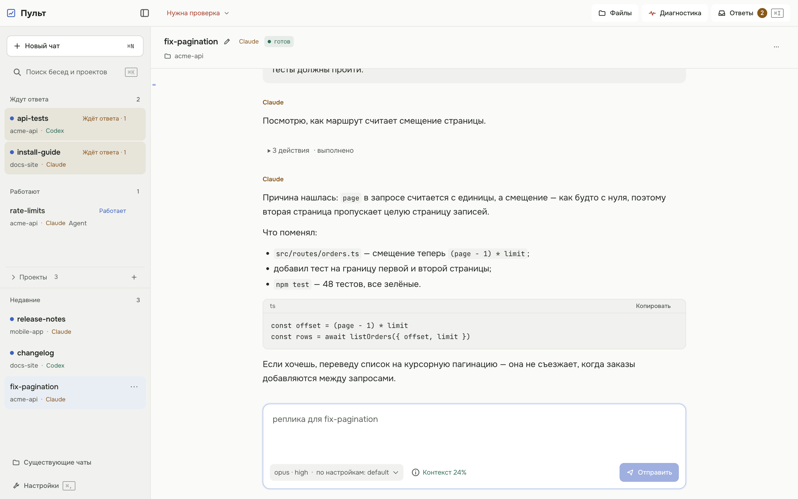
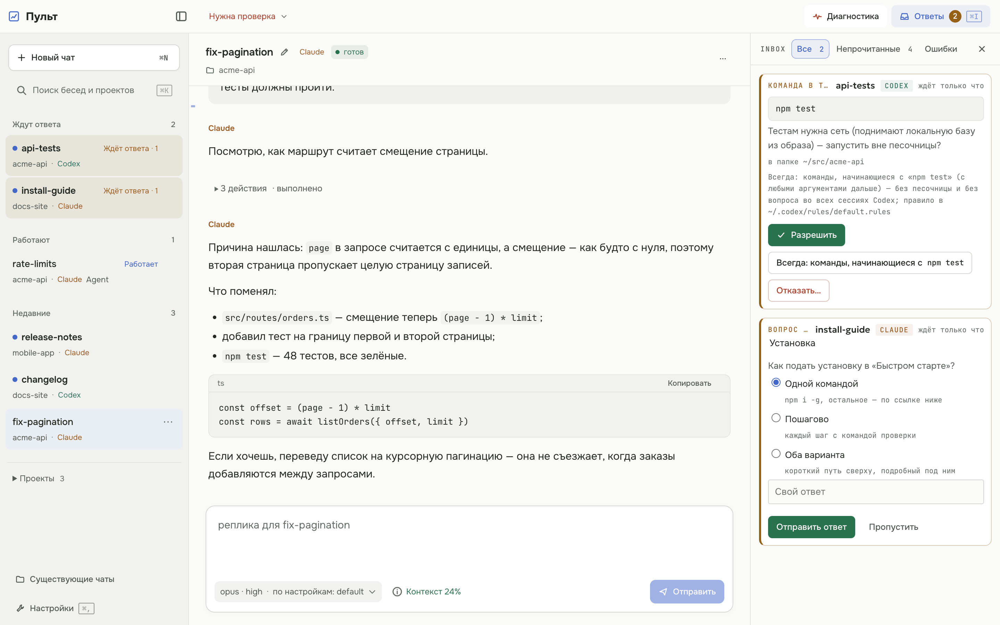
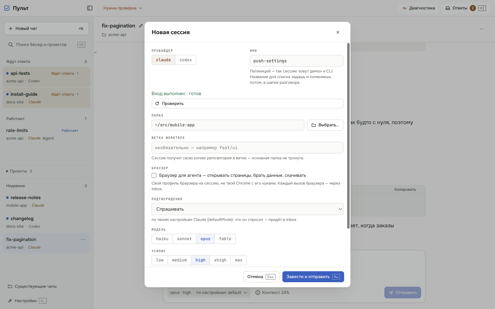
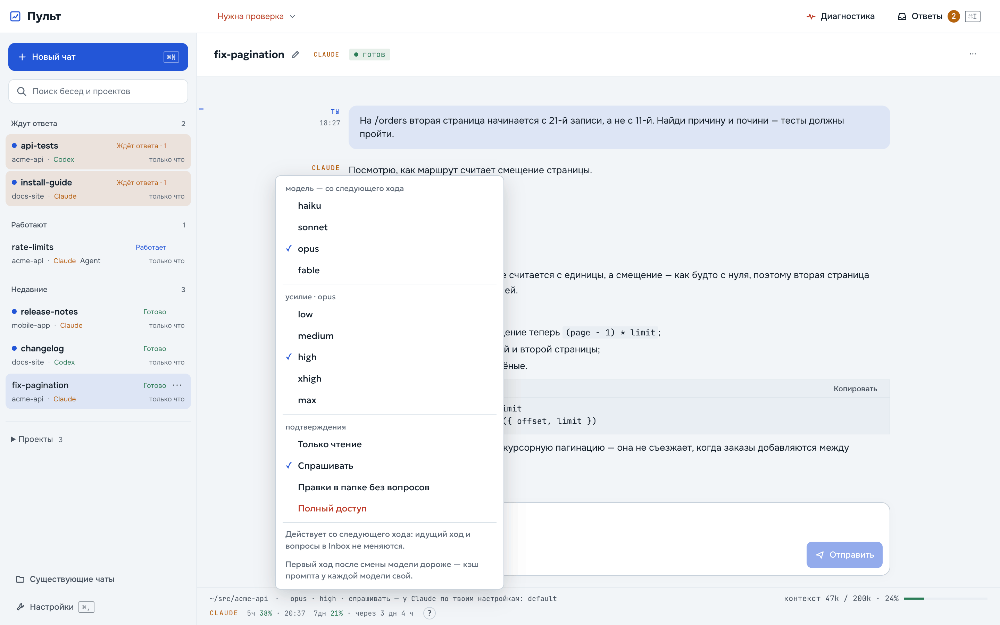

# Пульт

[English](README.md) · **Русский**

**Держи в фоне несколько агентов Claude Code и Codex и отвечай на все их вопросы о разрешениях в одном месте.**

<picture>
  <source media="(prefers-color-scheme: dark)" srcset="docs/images/hero-dark.png">
  <source media="(prefers-color-scheme: light)" srcset="docs/images/hero-light.png">
  
</picture>

Это полное руководство пользователя. Как Пульт устроен, собирается и тестируется — [`docs/DEV.md`](docs/DEV.md).

**Статус:** 0.3. Интерфейс и сообщения CLI пока только на русском. Адаптер `opencode` — в следующих версиях.

## Что умеет

- **Агенты работают, пока тебя нет.** Заводишь агента Claude Code или Codex в папке проекта — он работает дальше,
  когда закрываешь терминал или окно, а его разговор переживает перезагрузку (ход, шедший в этот момент, прерывается).
- **Один Inbox на все вопросы.** Захотел любой агент запустить команду или поправить файл, о котором спрашивает, —
  вопрос попадает в один список. Отвечаешь из окна или из терминала.
- **Твои CLI и твои подписки.** Пульт запускает `claude` и `codex`, которые ты сам поставил и в которые сам вошёл.
  Своей учётки и сервера у него нет, токенов он не читает.
- **Окно и CLI над одними агентами.** Всё, что делаешь в окне, можно сделать и скриптом через `pult …`.

## Как устроен

```
ты ──▶ pult (CLI) или Pult.app (окно) ──▶ pultd (фоновый демон) ──▶ твои процессы claude / codex
```

`pultd` — небольшой фоновый процесс: запускает агентов, хранит их разговоры и собирает их вопросы. Всё, что он делает,
пишется в журнал событий в `~/.pult`, поэтому CLI и окно всегда показывают одно и то же.

| слово | что значит |
|---|---|
| **сессия** (она же *агент*) | один разговор с Claude или Codex, привязанный к папке; `pult session …` и `pult agent …` — одна команда |
| **ход** | твоя реплика и всё, что агент делает, пока не ответит |
| **демон** | `pultd`, фоновый процесс; любая команда поднимает его сама |
| **Inbox** | список вопросов, которые ждут твоего решения |
| **режим подтверждений** | сколько сессии можно без вопросов (раздел «Как подтверждать действия») |
| **модель и усилие** | какой моделью работает CLI и насколько глубоко думает (`low` … `max`); уходят в CLI как есть |
| **тёплый процесс** | `--warm`: процесс `claude` живёт между репликами, каждая на 1–2 с быстрее |
| **worktree** | отдельная рабочая копия git на своей ветке, чтобы два агента не правили одни файлы |

## Что нужно

- **macOS на Apple Silicon** (демон, CLI и окно) **или Linux** (демон и CLI; окна под Linux нет).
- `git`.
- Хотя бы один CLI, поставленный **и залогиненный**: `claude` (Claude Code, вход — `claude /login`) или `codex`
  (Codex CLI, вход — `codex login`). Обоих не нужно. Пульт форм входа не показывает и ключей не читает — вход всегда
  делаешь ты в терминале.
- Node.js не обязателен: если в PATH нет node 22 или новее, установщик сам скачает официальную сборку nodejs.org той
  версии, что закреплена в пакете, сверит sha256 и положит её в `~/.pult/runtime`.

## Установка

**Одной командой — последний релиз.** `install.sh` — обычный скрипт на POSIX sh: скачай, прочитай, запусти.

```sh
curl -q --proto '=https' -fsSLO https://github.com/pawellazarew/pult/releases/latest/download/install.sh
less install.sh
sh install.sh --from https://github.com/pawellazarew/pult/releases/latest/download/pult.tgz
```

Установщик ставит Пульт в `~/.pult` (`--home`), кладёт симлинк `~/.local/bin/pult` (`--bin-dir`), ставит службу
(launchd на macOS, `systemd --user` на Linux; без неё — `--no-service`, демон тогда поднимается по требованию) и
показывает `pult doctor --no-net`. sudo не трогает, node в систему не ставит, `~/.zshrc` и PATH не правит — только
подсказывает.

**`pult: command not found`?** Значит, `~/.local/bin` нет в PATH. Добавь и открой новый терминал:

```sh
echo 'export PATH="$HOME/.local/bin:$PATH"' >> ~/.zshrc     # bash — ~/.bashrc
```

**Как выглядит удачная установка.** Последняя строка `pult doctor` — счёт проверок, например
`итог: ok 18 · warn 3 · fail 0`. Пара `[warn]` на свежей установке — норма, например
`[warn] Демон pultd: не отвечает (это нормально: демон поднимается по требованию)`. Под строкой, где надо что-то
сделать, — `почини:` и точная команда.

**Окно (macOS, Apple Silicon).** Сначала поставь CLI: Pult.app не несёт пакет в себе, а берёт его из `~/.pult`. Потом:

```sh
curl -q --proto '=https' -fsSLO https://github.com/pawellazarew/pult/releases/latest/download/Pult-arm64.zip
ditto -x -k Pult-arm64.zip /Applications
pult ui
```

Или скачай [`Pult-arm64.zip`](https://github.com/pawellazarew/pult/releases/latest/download/Pult-arm64.zip) браузером,
распакуй, перенеси `Pult.app` в `/Applications` и запусти `pult ui` (или открой приложение из Launchpad).

У окна своя версия (0.1.x), не такая, как у Пульта (0.3.x). `Pult-arm64.zip` из последнего релиза всегда подходит к
последнему Пульту, а если окно слишком старое для стоящего Пульта, оно само об этом скажет.

**Если macOS не открывает окно.** Подпись ad-hoc (`codesign --sign -`), нотаризации нет: сертификата разработчика Apple
за приложением нет. Zip, скачанный `curl`, обычно открывается без вопросов: curl не помечает файл как скачанный из
интернета. Браузер помечает, и macOS может отклонить первый запуск («Apple не удалось проверить…»). Тогда:

1. Попробуй открыть `Pult.app` один раз и закрой предупреждение.
2. Открой **Системные настройки → Конфиденциальность и безопасность**, найди внизу строку про Pult и нажми
   **«Всё равно открыть»** (кнопка появляется только после заблокированной попытки), затем подтверди.

Возможно, это придётся повторить для каждой новой версии окна.

**Из рабочей копии репозитория** (если собираешь сам):

```sh
git clone https://github.com/pawellazarew/pult.git && cd pult
npm ci && npm run build
alias pult="node $PWD/dist/cli/main.js"
pult daemon install --dev     # служба запускает эту рабочую копию: current -> корень пакета
```

**Из тарбола руками** (`pult-<версия>.tgz` — со [страницы релизов](https://github.com/pawellazarew/pult/releases)):

```sh
sh install.sh --from pult-<версия>.tgz                 # или https-адрес тарбола
sh install.sh --from pult-<версия>.tgz --no-service    # без службы: демон поднимается по требованию
sh install.sh --from … --home ~/.pult --bin-dir ~/.local/bin   # это значения по умолчанию
```

Свой node Пульта установщик кладёт в `PULT_HOME/runtime` (пин — `runtime.env`, зеркало — `PULT_NODE_MIRROR=https://…`).
Дальше он ставит версию через `pult update --from`, кладёт симлинк `~/.local/bin/pult` на лаунчер `PULT_HOME/bin/pult`
(он сам находит свой node), ставит службу и показывает `pult doctor`.

**Новая версия поверх стоящей** — `pult update` (подробности — «Обновление и откат»).

Всё состояние живёт в `PULT_HOME` (по умолчанию `~/.pult`, подробнее — «Где лежат данные»). Чтобы попробовать, не
трогая боевой, — `PULT_HOME=$(mktemp -d) pult …`.

## Быстрый старт

Возьми папку проекта — лучше git-репозиторий: так проще посмотреть и откатить то, что поменял агент.

```sh
pult doctor                                                   # всё ли на месте
pult agent start w --kind claude --cwd ~/code/app             # сессия с именем w; для Codex — --kind codex
pult agent prompt w "почини падающий тест" --wait             # реплика и ждать конца хода
pult agent read w                                             # что агент сказал
```

Имя сессии — короткий ключ латиницей (`w`, `fix-login`); человеческое название — потом:
`pult agent rename w "Починить тест входа"`.

**Когда агенту нужен ты.** `--wait` выходит с кодом **3**, если ход встал на вопросе (например, агент хочет запустить
команду за пределами своей папки). Тогда:

```sh
pult perm list                                                # id, сессия, инструмент, что именно хочет сделать
pult perm approve <id>                                        # или: pult perm deny <id> --reason "не трогай прод"
pult agent wait w                                             # дождаться конца хода
```

**Та же сессия в окне.** `pult ui`: сессия видна слева под папкой проекта, с разговором целиком. Закрыть окно ≠
остановить агента.

Рядом: `pult agent list|stop|rm|tree`, `pult usage` (окна лимита подписки: 5 часов и 7 дней), `pult events tail`.
Полный список — `pult --help`.

## Окно

Окно — тонкая оболочка Electron над тем же демоном: заводит агентов, показывает разговор, собирает запросы
разрешений в Inbox. Закрыть окно ≠ остановить агентов: демон живёт отдельно, после открытия история на месте.

```sh
pult ui                 # Pult.app из /Applications (или ~/Applications), иначе окно из рабочей копии
pult ui --dev           # сразу рабочая копия (PULT_UI_ROOT или корень пакета, из которого запущен CLI)
pult ui --print         # только показать, что будет запущено
```

Код 1 — окна нет: поставь его, как в разделе «Установка» (сам `pult ui` подскажет сборку из рабочей копии). Демона `pult ui` не трогает — окно поднимает его само
(служба → kickstart, незагруженная — bootstrap; иначе отсоединённый процесс), тем же кодом, что и CLI.

В окне агенты называются **сессиями**, и у CLI есть то же имя: `pult session …` — синоним `pult agent …`
(старая команда работает как раньше). Слева — единый список бесед: **Ждут ответа**, **Работают** и
**Недавние**, с поиском по названию, проекту и провайдеру. Клик открывает разговор, ⌘1…9 выбирают первые
девять бесед видимого списка. Раздел «Проекты» ниже списка позволяет добавить папку или начать беседу в ней.
Список проектов демон хранит в `PULT_HOME/projects.json`. ⌘K переводит фокус в поиск бесед, ⌘B скрывает или
возвращает список. Модель, усилие и режим доступа находятся в карточке ввода; контекст, лимиты и сведения о
сессии раскрываются рядом. При чтении старой части разговора кнопка «К последним» возвращает вниз.
Ошибка сначала показывает короткий вывод; полный ввод и вывод доступны по отдельному раскрытию.

**Картинки в беседе.** Локальные PNG, JPEG, GIF и WebP в Markdown и результаты инструментов показаны превью.
Клик увеличивает изображение: доступны масштаб, сохранение копии и открытие файла. Новые скриншоты MCP и
результаты генерации Codex сохраняются отдельно от журнала и доступны после перезапуска. Изображения читаются
из папки проекта, папки генераций Codex или хранилища этой сессии; максимум 20 МБ на файл. Внешние картинки
остаются ссылками. Старые скриншоты, которые прежняя версия уже заменила текстовой заглушкой, не восстановятся.
Обычные вызовы инструментов собраны в раскрываемые группы; ошибки и картинки остаются снаружи.

**Файлы в ответе.** Служебные ссылки Codex на выходные файлы и абсолютные Markdown-ссылки показаны кнопкой
с именем файла. Документ открывается системным приложением по клику; рядом — кнопка показа в Finder.
Для удалённого или перемещённого файла показана ошибка. Программы и неизвестные типы только показываются
в Finder; старое окно без команды открытия тоже использует Finder.

**Меню сессии и проекта.** Правый клик по строке или «⋯»: у сессии — переименовать, показать папку в Finder,
в архив и обратно, удалить; у проекта — новая сессия здесь, закрепить или убрать из проектов, показать в Finder.
Архив — секция внизу дерева; реплика в архивную сессию возвращает её (`pult session archive|unarchive <имя>`).
Сессия без названия называется сама по первой реплике (дешёвый запрос к haiku через страж сети; не вышло — первые
слова задачи); выключить — `"autoTitle": false` в `config.json`.

**Файлы в поле.** Перетащи файлы или скопируй их в Finder и нажми ⌘V в поле реплики (и в «первой реплике» диалога
«+ Сессия»): встанут их полные пути, путь с пробелом — в кавычках. Папка, брошенная на форму «+ Сессия» вне реплики,
становится папкой сессии, как выбор через «Выбрать…».

**Что делает ход сейчас.** Под последней репликой, пока идёт ход, — одна живая строка с секундами: «запускается…»
(страж сети, запуск процесса), «думает…», «пишет…», «выполняет: Bash npm test…», «ждёт тебя» со ссылкой на запрос в
Inbox, «фоновые задачи: N». Если провайдер отдаёт размышления (сводка у Codex; у Claude — когда они не скрыты), под
строкой есть свёрнутое «Размышления». В списке у работающей беседы — коротко: «думает», «пишет», «Bash». Строка живёт только
в окне: в журнал не пишется ни она, ни текст размышлений.

**Фоновые субагенты.** Ход закрывается по ответу модели, даже если она запустила фоновых субагентов:
сессия сразу принимает новые реплики, а процесс Claude живёт, пока фоновые задачи не доделаны (в окне —
«в фоне · N»). Итог фоновой задачи приходит в ленту отдельным ходом. Потолок жизни такого процесса —
`backgroundMaxMs` в `config.json` (по умолчанию 3 ч). `pult agent prompt --wait` ждёт ответа на реплику,
а не итогов фоновых задач.

**Из рабочей копии:**

```sh
npm ci && npm run build                       # пакет и интерфейс (dist/ui)
cd shell && npm ci && npm start               # окно с PULT_UI_ROOT = эта рабочая копия
npm run ui:watch                              # в корне: пересборка интерфейса на лету, в окне ⌘R
```

**Настройки (⌘,).** «Новая сессия» — провайдер, модель, усилие, режим, тёплый процесс, браузер и ветка worktree по
умолчанию для каждого провайдера и «Подставлять последний выбор»: «+ Сессия» откроется с тем, что выбрано в прошлый
раз (кроме реплики и «Полного доступа» — он не подставляется никогда), иначе — с умолчаниями. Пишется только раздел
`newSession` в `config.json`. «Внешний вид» — темы и цвета появятся после редизайна. Модель, усилие и режим живой
сессии — клик по «opus · high · спрашивать» в карточке ввода.

**Pult.app из рабочей копии:**

```sh
cd shell && npm ci && npm run dist:mac        # → shell/out/mac-arm64/Pult.app
node scripts/check-app.mjs --launch           # fuses, подпись, живой прогон во временном PULT_HOME
cp -R out/mac-arm64/Pult.app /Applications/   # руками
```

Pult.app не несёт пакет в себе — берёт интерфейс и код протокола из `PULT_HOME/current/lib/node_modules/pult`
(поставленная версия, `pult update --from`) или из `PULT_UI_ROOT`. Демона запускает настоящим node >= 22:
`PULT_NODE` → `PULT_HOME/node-path` (его пишет `pult daemon install`) → PATH → `/opt/homebrew/bin`, `/usr/local/bin`.
Fuses выключены: `ELECTRON_RUN_AS_NODE`, `NODE_OPTIONS` и `--inspect` на Pult.app не действуют, подменённый
`app.asar` не запускается.

**Убрать из списка (M8d).** Любой проект дерева убирается из меню «⋯»: закреплённый без сессий — просто снимается
закрепление; папка с сессиями — после вопроса «N сессий уйдут в архив, папка на диске не трогается» её сессии уходят в
«Архив», и папка пропадает из дерева. Занятые сессии (идёт ход, ждёт тебя, очередь) сначала надо остановить. Новая сессия в этой папке (или реплика в архивную) возвращает её.

**Горячие клавиши:** ⌘N — новый агент · ⌘1…9 — агенты по порядку · ⌘I — Inbox · ⌘Enter — разрешить выделенный
запрос (только видимый: свой у открытой сессии или карточку в открытом Inbox; в поле реплики — только запрос этой сессии) · Esc — стоп хода (с подтверждением) · в поле ввода Enter — отправить, Shift+Enter — новая строка.
В русской раскладке работают те же клавиши.

**Что умеет (О1):** список агентов (ждущие решения — первыми, провайдер, статус, папка/ветка, последняя активность);
«+ Агент» — провайдер, папка системным диалогом, ветка worktree, модель и усилие, первая реплика сразу; разговор —
реплики, ответ по ходу, инструменты свёрнутыми строками, субагенты вложенным блоком, diff правок, причина провала;
Inbox всех агентов — разрешить или отказать с причиной, запрос текущего агента виден и в ленте; техническая сводка под индикатором подключения — демон
(версия, режим, аптайм), страж сети и лимиты claude и codex; «Диагностика» (`doctor`) с
командами «почини»; плашки «демон недоступен» (кнопка «запустить»), «провайдер остановлен» (снять остановку),
«сеть заблокирована», лимит; уведомления macOS о запросе и конце хода, пока окно не в фокусе. Тема — системная.

**Непрочитанное и очередь (О2 «внимание», 0.2.21).** Сессия становится непрочитанной, когда ход закончился, упал,
упёрся в лимит или страж сети или агент спросил, а ты её с тех пор не открывал. В списке это точка
(красная — у ошибки). Открыл сессию в окне, которое перед глазами, — точка
гаснет через полсекунды. Отметку «прочитано» хранит демон, поэтому окно, строка меню и `pult agent list` (точка
`●` за именем, `·` у прочитанных; `pult agent seen <имя> [--unread]`) видят одно и то же.

- **Значок на доке** — сколько сессий ждут тебя: разрешение или вопрос плюс непрочитанная ошибка. Непрочитанные
  «готово» туда не идут. Число рядом со значком в строке меню — то же.
- **⌘⌥L** — следующая сессия, которая ждёт тебя: сначала ошибки, потом разрешения и вопросы, потом непрочитанные
  «готово». **⌃⌘L** — отложить текущую: она уходит в конец своей очереди и не гаснет, пока ты к ней не вернёшься
  или с ней не случится новое; окно переходит к следующей. **⌥⌘U** — пометить текущую непрочитанной, чтобы вернуться позже. Вне macOS — Ctrl+Alt+L,
  Ctrl+Shift+L, Ctrl+Alt+U. Все три — в справке ⌘/.
- **Ошибки в Inbox.** Упавший ход, исчерпанный лимит и отказ стража — карточка с причиной и кнопками «Повторить»
  (реплика упавшего хода уходит заново; у ошибки вне хода — лимита аккаунта на простое, фонового хода — кнопки
  нет) и «Открыть». Архивные сессии в Inbox, очередь и значок не попадают. Фильтр в шапке Inbox: «Все» (запросы и ошибки), «Непрочитанные»
  (все непрочитанные сессии), «Ошибки».

**Очередь реплик, уведомления, сторож тишины (О2, 0.2.23).**
- **Очередь.** Пока идёт ход, поле ввода не заперто: Enter ставит реплику в очередь (она видна под полем; × убирает,
  ↑/↓ переставляют). Ход кончился — следующая уходит сама. Очередь живёт в демоне: переживает закрытие окна.
  **⌘Enter** во время хода — «прервать и сказать»: ход останавливается, реплика уходит сразу. Ход упал, упёрся в
  лимит или его прервали (или демон перезапустился посреди хода) — очередь стоит: «Очередь стоит: ход не удался» и
  кнопка «Продолжить». Из терминала: `pult agent prompt <имя> "текст" --queue` или `--interrupt`.
- **Правка реплики в очереди (0.3.2).** «Изменить» у реплики открывает её текст на том же месте: Enter — сохранить,
  Shift+Enter — новая строка, Esc — отмена. Пока правка открыта, очередь ждёт: эта реплика и те, что за ней, не уйдут
  (не дольше 10 минут — потом реплика уйдёт с прежним текстом). Реплика успела уйти или её убрали — исправленный
  текст встанет в поле ввода, он не теряется.
- **Уведомления.** Окно не в фокусе: о конце хода — только если ход шёл дольше 20 с; о вопросах, разрешениях и
  ошибках — всегда. Звук по виду: вопрос — Glass, готово — Pop, ошибка — Basso. Больше двух за 10 с — остальные
  приходят одной сводкой «ещё N сессий ждут тебя».
- **Сторож тишины.** Ход молчит 10 минут — в Inbox карточка «Похоже, завис» с кнопками «Прервать» и «Ждать». Сам ход
  демон не обрывает.
- **Настройки** — в `PULT_HOME/config.json`; демон читает его на старте (`pult daemon stop` — следующая команда поднимет его с новыми):
  `"notify": {"minTurnSeconds": 20, "sound": true}` — порог конца хода и звук (`false` — тихо);
  `"watchdog": {"silenceMinutes": 10}` — сторож тишины (`0` — выключен);
  `"notifyCommand": "…"` — своя команда на каждое событие внимания (готово, упал, вопрос, лимит, страж, завис), работает
  и без окна. Её запускает демон: `/bin/sh -c`, 10 с на всё, одна за раз на сессию; переменные `PULT_SESSION`,
  `PULT_TITLE`, `PULT_KIND` (`done|failed|ask|limit|blocked|stalled`), `PULT_TEXT`, остальное окружение — белый
  список (HOME, PATH и т.п.). Пример — в Telegram: `"notifyCommand": "$HOME/.pult/notify-telegram.sh"`, а в
  скрипте (права 0700) токен читается из своего файла, не из строки конфига:
  `TOKEN=$(cat "$HOME/.pult/telegram-token"); curl -s "https://api.telegram.org/bot$TOKEN/sendMessage" -d chat_id=… --data-urlencode "text=$PULT_TITLE: $PULT_KIND $PULT_TEXT"`.

**Чат (0.3.0).** Поле ввода пустеет сразу по Enter, реплика встаёт в ленту бледной «отправляется…», пока демон её не
примет; отказ (например, «Пульт обновляется») возвращает текст в поле — если ты уже набрал новое, отвергнутое встаёт
над ним, ничего не теряется. В твоих репликах работают ссылки, `код`, блоки ```…```, жирный и курсив; остальное —
как набрано (отступы, переводы строк, `#` и `-` в начале строки), так что вставленный код и diff не портятся. У каждой
реплики и ответа — «Копировать» слева под временем (видна при наведении или Tab): в буфер уходит исходный текст из
журнала (секреты в твоих репликах там замаскированы так же, как в ленте).

**Поиск, метки, экспорт (О2, 0.2.24).**
- **⌘⇧F** (вне macOS — Ctrl+Shift+F) — поиск по всем разговорам: твои реплики, ответы модели и вызовы инструментов
  (имя, команда, путь, шаблон), регистр не важен. Выдача — по сессиям, новые первыми; ↑/↓ и Enter (или клик)
  открывают сессию прямо на этом месте: окно само догрузит раннюю историю и подсветит найденное. Выводы
  инструментов и удалённые сессии не ищутся.
- **Метки реплик.** Слева от ленты — полоса с меткой на каждую твою реплику (на её высоте в разговоре); клик ведёт к
  реплике. **⌥↑ / ⌥↓** — к предыдущей и следующей реплике (когда фокус не в поле ввода или поле реплики пустое).
- **Экспорт в Markdown** — в меню сессии («⋯» или правый клик): разговор целиком — реплики, ответы, строка на каждый
  инструмент с исходом, субагенты, ошибки и лимиты — ложится в `PULT_HOME/exports/<имя>-<время>.md`, Finder
  показывает файл. Из терминала: `pult agent export <имя>` печатает путь, `--stdout` — сам текст (файл тогда не остаётся).

**Ссылки `pult://` (О3, 0.2.26).** Ссылка открывает окно — из Raycast, заметок, сообщения или терминала (`open "pult://…"`):
- `pult://session/<имя>` — окно на сессии, например `pult://session/pult-ui`;
- `pult://new?path=<папка>&prompt=<реплика>&provider=claude|codex` — диалог «Новая сессия» с заполненными полями.
  Все параметры необязательны, значения — в процентной записи (пробел — `%20`; `+` остаётся плюсом):
  `pult://new?path=%2FUsers%2Fuser%2Fcode%2Fsite&prompt=%D0%9F%D0%BE%D1%87%D0%B8%D0%BD%D0%B8%20%D1%82%D0%B5%D1%81%D1%82%D1%8B&provider=codex`.

Ссылка только заполняет диалог: сессию заводит «Завести», ничего не запускается само. Ссылки — чужой ввод, поэтому:
- папку окно подставляет, только если это твой проект или папка одной из сессий (симлинки раскрываются); иначе пишет
  «папка из ссылки не из твоих проектов — выбери сам», и папку выбираешь кнопкой «Выбрать…»;
- реплика — до 10 000 знаков и 200 строк, без невидимых символов; под полем — счётчик строк и знаков;
- «Завести» первую секунду заперта, окно полсекунды не принимает клавиши и не ставит курсор в поле — Enter,
  нажатый в другом приложении, ничего не отправит; открытый диалог новая ссылка не подменяет;
- кривая ссылка или вторая быстрее чем через 1,5 с не делает ничего, причина — в логе окна.

В Raycast — Quicklink с адресом вида `pult://new?path=%2FUsers%2Fuser%2Fcode%2Fsite&prompt={argument}` (Raycast
кодирует аргумент сам). Схему `pult` macOS отдаёт Pult.app из `/Applications`; окно из рабочей копии (`npm start`) её
не перехватывает.

**Чего пока нет (О2):** дерева агентов графом, чужих сессий Claude/Codex, палитры ⌘K,
закрепления, настроек и расхода по агентам. Окно при открытии доигрывает весь журнал: на журнале за недели первый показ может занять секунды.

## Демон и служба

Любая команда, которой нужен демон, поднимает его сама — отсоединённым процессом, который переживает закрытие
терминала. Служба (launchd на macOS, `systemd --user` на Linux) держит его и после перезагрузки:

```sh
pult daemon install           # поставить службу (активная версия уже стоит)
pult daemon install --print   # показать файл службы и команды, ничего не записывая
pult daemon status            # версия, pid, режим service | on-demand, строка службы
pult daemon logs -n 50        # журнал демона
pult daemon stop              # остановить; служба его НЕ поднимает, поднимет следующая команда
pult daemon uninstall         # снять службу; PULT_HOME не трогается
```

- **macOS: диалог доступа к ~/Desktop.** Если рабочая копия или папка агента лежит в `~/Desktop`, `~/Documents` или
  `~/Downloads`, macOS спросит «“node” would like to access files in your Desktop folder» — нажми «Разрешить», иначе
  демон под службой не прочитает папку.
- **Linux: linger.** Без него `systemd --user` гасит демона вместе с последней сессией; `install` включает его сам,
  а без прав печатает `sudo loginctl enable-linger <user>`.

## Агенты

```sh
pult agent start w --kind claude --cwd ~/code/app [--model haiku] [--effort low] [--warm] [--title "название"]
pult agent start c --kind codex  --cwd ~/code/app [--effort low]
pult agent rename w "Починить VPN"                      # название для списков и окна; без текста — снять
pult agent prompt w "текст" --wait [--timeout 600000]   # без --wait — вернуться сразу, ход идёт в фоне
pult agent wait w                                       # дождаться конца хода
pult agent read w [--since N] [--format json]           # текст модели или события NDJSON
pult agent tree w                                       # субагенты и вызовы инструментов
pult agent export w [--stdout]                          # разговор в Markdown: путь к файлу или сам текст (без файла)
pult agent stop w                                       # снять текущий ход
pult agent rm w                                         # удалить агента
pult usage                                              # окна лимита подписки: 5 часов и 7 дней
```

- **Папка — проект, а не дом.** `--cwd` не может быть `PULT_HOME` (`~/.pult`) или папкой над ним (`~`): агент, который
  правит файлы без вопроса, переписал бы `config.json` Пульта (а `notifyCommand` из него демон исполняет сам). Если
  `PULT_HOME` лежит не в доме, а папка — `~` или выше, сессия заводится, но с предупреждением: агент сможет менять
  `~/.claude`, `~/.codex`, `~/.zshrc` и др. без вопросов. Сессия, заведённая с такой папкой раньше, работает только в
  «Только чтение».
- **Агент — это один разговор.** У него своя память (сессия `claude` или тред `codex`), папка и модель; разговор
  переживает рестарт демона и перезагрузку. Новый агент — новый разговор с чистого листа, а не «роль».
- **Имя и название.** `w` — имя: ключ агента для демона и CLI, латиницей, не меняется (на нём стоит журнал).
  Название — свободный текст до 60 знаков для списков и окна: `pult agent rename` или карандаш в шапке разговора.
- **Модель и усилие** уходят в CLI как есть: у `claude` — `haiku|sonnet|opus|fable` и `low|medium|high|xhigh|max`,
  у `codex` уровни объявляет модель (у модели по умолчанию — `low…ultra`). Задаются при заведении агента и меняются
  потом: `pult agent set w --model sonnet --effort medium` (или меню у поля ввода) — со следующего хода, разговор тот
  же. Модель, в окно которой разговор не влезет («не влезет: 300k > 200k»), — только с `--yes`. Первый ход после смены
  модели дороже: кэш промпта у каждой модели свой. Тёплый процесс `claude` сменится на границе хода; пока идут фоновые
  задачи — после них.
- **Умолчания `pult agent start`.** Что не задано флагом, берётся из `config.json` → `newSession.defaults` (окно →
  «Настройки», ⌘,): модель, усилие, режим и браузер провайдера из `--kind` (по умолчанию claude). Провайдер и `--warm` —
  только флагом, последний выбор окна в CLI не идёт: скрипт должен давать один и тот же результат.
- **claude.** По умолчанию каждая реплика — свой процесс `claude` с `--resume`: проще и переживает обрывы.
  `--warm` держит процесс живым между репликами (быстрее на 1–2 с, снимается через 20 минут простоя).
- **codex.** Один `codex app-server` на всех агентов codex; агенты — треды внутри него и идут параллельно.
  `--warm` для codex не нужен.
- **Разговор переживает рестарт демона.** После `pult daemon stop` или перезагрузки следующая реплика
  возобновляет тот же разговор.
- **Коды выхода** `pult agent prompt --wait`: 0 готово · 1 ошибка · 2 таймаут · 3 ждёт человека (смотри
  `pult perm list`) · 4 сеть заблокирована стражем · 5 провайдер недоступен или исчерпан лимит подписки.

## Inbox разрешений

Всё, на что агент спрашивает разрешение (правка файла, команда за пределами рабочей папки), попадает в Inbox и ждёт тебя:

```sh
pult perm list                          # id, агент, инструмент, что именно хочет сделать
pult perm approve p1-3fa9c2              # разрешить ОДИН раз (id — из perm list)
pult perm approve p1-3fa9c2 --session    # и такие же действия до конца сессии (если провайдер предложил)
pult perm approve p1-3fa9c2 --rule       # всегда: постоянное правило провайдера (если провайдер предложил)
pult perm deny p1-3fa9c2 --reason "почему"  # отказать; агент увидит причину
```

<picture>
  <source media="(prefers-color-scheme: dark)" srcset="docs/images/inbox-dark.png">
  <source media="(prefers-color-scheme: light)" srcset="docs/images/inbox-light.png">
  
</picture>

- **Показано не всё — карточка говорит об этом.** Фильтр секретов прячет в карточке почту, токены и логины в адресах
  (`<email>`, `<token>`, `<redacted>`), а у Codex длинные поля подрезаны. Исполнится при этом ИСХОДНАЯ команда — так
  `ssh root@prod.example.com` в карточке выглядит как `ssh <email>`. Такая карточка помечена «Показано не всё», а
  `pult perm list` пишет `ВНИМАНИЕ: показано не всё`; не уверен, что там, — отказывай. У вопроса модели строка про
  вопрос: модель видит его целиком.
- **Процесс агента умер — вопрос снят.** Умер `claude`, который спрашивал, — его карточка уходит из Inbox отказом
  («процесс агента завершился»), как у Codex.
- **Молчание — отказ.** Никто не ответил за 10 минут (`permTimeoutMs`), демон недоступен, агента остановили —
  ответ «нет». Недоступный хозяин не означает «разрешаю».
- **По умолчанию — один раз.** «Разрешить» и ⌘Enter в окне, голое `perm approve` — ровно это действие. Шире — только
  своей кнопкой и только когда провайдер сам это предложил на этот запрос (`pult perm list` пишет, что можно):
  «В этой сессии» — Codex не спросит про такие же до конца сессии; «Всегда: команды, начинающиеся с `<префикс>`» —
  правило-префикс (с любыми аргументами дальше): без песочницы и без вопроса во всех сессиях Codex; «Всегда пускать
  в сеть к `<хост>`» — то же для сети. Оба ложатся в `~/.codex/rules/default.rules`, Пульт их потом не снимет. Claude сегодня не предлагает Пульту правил, поэтому у его карточек только
  «один раз».


## Как подтверждать действия

Режим выбирается при заведении сессии (`--approval` или поле «подтверждения» в «+ Сессия») и живёт в её записи —
переживает рестарт демона. Сменить у живой сессии — клик по «модель · усилие · режим» в карточке ввода или
`pult agent set <имя> --approval <режим>`: действует со следующего хода (идущий ход и вопросы в Inbox не меняются),
`full` — только с подтверждением (`--yes`). Режим, в котором браузер не включается, выключает его, а возврат в режим
тише включает обратно.

<picture>
  <source media="(prefers-color-scheme: dark)" srcset="docs/images/new-session-dark.png">
  <source media="(prefers-color-scheme: light)" srcset="docs/images/new-session-light.png">
  
</picture>

| режим | Claude | Codex |
|---|---|---|
| `read-only` — только чтение | правки запрещены, каждую команду спросит (`manual` без Write/Edit) | песочница `read-only`, шире — через Inbox |
| `ask` — по умолчанию | твои настройки Claude, вопросы — в Inbox | `workspace-write`, шире — через Inbox |
| `workspace` — правки в папке без вопросов | `acceptEdits` | `workspace-write`, без вопросов |
| `full` — полный доступ | `bypassPermissions` | `danger-full-access`, без вопросов |

`full` — агент делает что угодно без вопросов, песочницы нет; заводится только с подтверждением (`--yes` в CLI).
У Codex в `workspace`/`full` твои MCP-серверы тоже работают без вопросов. Браузер для агента не включается у Claude в `full` и у
Codex в `workspace`/`full`: там спросить про вызов браузера некого.

<picture>
  <source media="(prefers-color-scheme: dark)" srcset="docs/images/settings-menu-dark.png">
  <source media="(prefers-color-scheme: light)" srcset="docs/images/settings-menu-light.png">
  
</picture>

## Worktree: отдельная рабочая копия на агента

Два агента в одной папке правят одни файлы и делят один индекс git. `--worktree` даёт агенту свою рабочую копию того же
репозитория на своей ветке:

```sh
pult agent start w1 --kind claude --cwd ~/code/app --worktree feat/login                    # ветки нет — от HEAD
pult agent start w2 --kind codex  --cwd ~/code/app --worktree fix/crash --base origin/main  # от указанной базы
pult agent rm w1                 # агент удалён, worktree ОСТАЁТСЯ — печатается путь и команда уборки
pult agent rm w2 --worktree      # ещё и git worktree remove — только если дерево чистое
```

Папки — в `PULT_HOME/worktrees/`, вне репозитория. Один worktree — один агент. Ветка не удаляется никогда: в ней может
быть неотправленная работа.

## Браузер для агента и свои MCP-серверы (О3, 0.2.25)

Агенту иногда нужен браузер: открыть страницу с JavaScript, взять с неё данные, скачать файл. WebFetch этого не умеет.
Галочка «Браузер для агента» в «+ Сессия» (или пункт меню сессии) подключает к сессии
[Playwright MCP](https://github.com/microsoft/playwright-mcp) на твоём Google Chrome:

```sh
pult agent start w --kind claude --cwd ~/code/app --browser [--headed]   # --headed — окно браузера видно
pult agent browser w on|off [--headed]                                   # вкл/выкл — со следующего хода
pult browser install                                                     # поставить заранее (иначе — сам, при первой сессии с браузером)
pult browser                                                             # стоит ли и найден ли Chrome
```

- **Свой профиль на сессию.** Браузер агента — не твой Chrome с его куками и паролями, а отдельный профиль в
  `PULT_HOME/browser/<сессия>/profile`. Войти на нужный сайт можно руками в этом профиле: включи «показывать окно
  браузера», войди — вход переживёт перезапуск. Удаление сессии удаляет и профиль.
- **Скачивания и снимки страниц** — в `PULT_HOME/browser/<сессия>/downloads`; в сведениях у поля ввода кнопка «браузер ·
  скачивания» открывает папку в Finder. Агент читает эту папку без вопроса (только чтение). Загрузить на сайт браузер
  может только файлы из этой папки. После удаления сессии папка остаётся — до новой сессии с тем же именем.
- **Каждый вызов браузера — через Inbox**, как любой другой инструмент: «открыть страницу», «кликнуть», «ввести»
  ждут твоего «да». Так и при `defaultMode: auto` в настройках Claude: Пульт добавляет сессии правило «спрашивать про
  браузер всегда». В режиме `bypassPermissions` браузер для Claude не включается вовсе.
- **Исполнение кода запрещено**: инструменты `browser_run_code_unsafe` (код на твоей машине) и `browser_evaluate`
  (JavaScript страницы) агенту недоступны.
- **Что ставится.** `@playwright/mcp` прибитой версии (`0.0.83`) с зависимостями — `npm ci` по lock-файлу из пакета Пульта
  (суммы sha512), в `PULT_HOME/mcp/`, без install-скриптов; свои браузеры Playwright не качаются — работает системный
  Chrome. Нет Chrome — `pult doctor` предупредит.
- **Codex** получает браузер в конфиг треда (сервер `pult_browser`, со спросом на каждый вызов); вопрос Codex о вызове
  — в Inbox с аргументами. Включить или выключить браузер у Codex посреди разговора можно, но подхватит он это после
  перезапуска демона (`pult daemon stop && pult daemon start`, разговор сохранится) — лента об этом скажет.

**Свои MCP-серверы.** `--strict-mcp-config` отрезает от сессий Claude твои MCP-серверы из `~/.claude.json`. Нужные
можно вернуть явным списком: окно → doctor → «MCP-серверы…» или

```sh
pult mcp list                    # что есть в ~/.claude.json; ● — подключён
pult mcp select github linear    # подключать к сессиям Claude эти (со следующего хода); --none — ни одного
```

Пульт этот файл только читает; выбранного имени в нём нет — сервер не подключается, `pult doctor` скажет. Вызовы
своих серверов тоже идут через Inbox. Серверы проекта (`.mcp.json`) — в следующих версиях: это код репозитория, и подключать его
по имени небезопасно. Codex свои серверы берёт из `~/.codex/config.toml` сам — Пульт их ему не дублирует.

## Обновление и откат

**В окне: «Настройки» (⌘,) → «Обновления» → «Проверить сейчас» / «Обновить до X».** Там видны версии пакета и окна,
состояние канала («Установлена последняя версия», «Доступна X» со ссылкой «Что нового» или текст ошибки) и когда канал
проверяли в последний раз. «Обновить до X» работает как кнопка в плашке сверху (ниже): ждёт конца идущих ходов, потом
демон обновляется и перезапускается, окно переподключается само. Флаг «Проверять обновления автоматически» —
это `updates.check` в `config.json`; адрес канала окно не меняет.

В терминале:

```sh
pult update                         # новая версия из релизов GitHub: проверить, скачать, поставить
pult update --check [--json]        # только проверить: код 0 — последняя, 10 — есть обновление
pult update --from pult-<версия>.tgz   # поставить тарбол руками
pult update --list                  # версии на диске: current, previous, bad
pult update --to <версия>           # вернуться на версию из pult update --list
pult update --app [--force]         # обновить окно (Pult.app, macOS) из того же канала
pult update --app --rollback        # вернуть прежнее окно, если новое не заработало при первом запуске
```

`pult update` (и `--from`, `--to`) перезапускает демона, поэтому, пока идут ходы, отказывает: «идут ходы: N — …
дождись или --force»; `--force` — обновить сразу, оборвав их. «Обновить» в окне ходы ждёт само.

**Голый `pult update`** берёт `latest.json` последнего релиза
(`https://github.com/pawellazarew/pult/releases/latest/download/latest.json`), проверяет подпись ключом релизов,
зашитым в Пульт, и ставит версию, только если она новее стоящей. Тарбол скачивается в `PULT_HOME/downloads`,
размер и sha256 сверяются с подписанным манифестом, дальше всё как у `--from`. Чужая подпись, не тот sha256 или
http вместо https — отказ одной строкой, ничего не ставится. Назад канал не откатывает: старый `latest.json` отвечает
«ставить нечего».

**Демон проверяет сам**: через минуту после старта, потом раз в 6 ч, а ещё когда окно возвращается на экран, если
последней проверке больше часа (по таким просьбам — не чаще раза в 10 минут на все окна). Что при этом уходит в сеть и
как выключить — «Сеть и приватность». Тарбол и окно скачиваются, только когда ты жмёшь «Обновить» («Обновить окно») или запускаешь `pult update` (`--app`). Свой адрес
`latest.json` (только https) — `"updates": {"url": "https://…"}` или `PULT_UPDATE_URL`.

**Канал не ответил** (нет сети, GitHub вернул 404 — например, в канале ещё нет релиза) — это не поломка: в окне плашки
нет, `pult update --check` и пункт «Канал обновлений» в `pult doctor` (предупреждение, не ошибка) так и говорят; ставь
версии `pult update --from <тарбол>`.

**В окне** новая версия — тихая строка сверху: «Доступна X · Что нового · Обновить» (крестик прячет её до
следующей версии). «Обновить» при идущих ходах их не обрывает: «Обновлю после окончания ходов (N идут) · Сейчас» —
обновление начнётся само, когда кончится последний ход; «Сейчас» — не ждать (идущие ходы прервутся, сессии
возобновятся после рестарта). Пока обновление ставится («Обновляю…»), новые реплики не уходят — «Пульт обновляется —
отправь после перезапуска», текст остаётся в поле. Не встало (проба и откат) — строка «Обновление до X не встало,
вернул Y» с путём к журналу. Демон перезапускается, окно переподключается само. Если новому пакету нужно окно новее
твоего, вместо «Обновить» — «сначала обнови окно» с кнопкой «Обновить окно» (или ссылка на релиз, если окно само
не обновляется). В окне старше 0.1.14 кнопка подскажет `pult update` в терминале.

**Окно обновляется само** (macOS, Apple Silicon). В релизе окно новее стоящего — в «Настройках» → «Обновления» строка
«Окно: 0.1.15 → доступно 0.1.16 · Обновить окно», в плашке — «Доступно новое окно». Всё делает демон: качает zip окна,
сверяет размер и sha256 с тем же подписанным манифестом, проверяет id приложения, версию, архитектуру и подпись бандла,
кладёт новое окно рядом со старым, закрывает окно, меняет `Pult.app` на месте двумя переименованиями и открывает
новое. Новое не поднялось и не заработало за 60 с — прежнее возвращается и открывается, а эта версия сама больше не
предлагается (повторить — `pult update --app --force`). Демон остановили посреди замены — следующий старт доводит
или откатывает её. Окно было закрыто — прежнее держится до первого запуска нового; не заработало — «Вернуть» в
«Настройках». Другое открытое окно (вторая копия Pult.app, окно рабочей копии) надо закрыть; кнопка есть только
в поставленном окне. Агенты всё это время
работают, недописанная реплика в поле переживает перезапуск окна. Нет прав на папку окна (не администратор и
`/Applications`) — ничего не трогается, Пульт подскажет, как заменить окно руками (`Pult-arm64.zip`, как в «Установке»).
Окно не закрылось за 10 с — отказ, закрой его сам (⌘Q) и повтори.

Версии лежат в `PULT_HOME/versions/<v>`, активная — симлинк `current`. После переключения демон перезапускается
и проверяется: не ответил, назвал не ту версию или упал за 2 с — `current` возвращается на прежнюю, новая помечается
`bad` и остаётся на диске для разбора; сама из канала она больше не ставится (`pult update --to <v>` — руками).
Агенты переживают обновление: разговоры возобновятся.

## Сеть и приватность

Телеметрии нет. Кроме трафика самих агентов, Пульт делает только такие запросы:

- **Проверка страны выхода.** Провайдеры не обслуживают часть стран, и запрос оттуда может стоить тебе учётки. Поэтому
  перед первым ходом агента и перед любым ходом после простоя дольше 60 с Пульт проверяет страну выхода тем же путём,
  которым пойдёт агент: `https://api.anthropic.com/cdn-cgi/trace` (запасной — `https://cloudflare.com/cdn-cgi/trace`).
  Страна неизвестна или в списке-страже (`RU, BY, CN, IR, KP, SY, CU` — собственный осторожный список Пульта, не
  официальный) — ход не запускается (код 4): лучше не начать ход, чем рискнуть учёткой. Поменять список или разрешить
  только выбранные страны — «Страж сети» ниже.
- **Название сессии.** Сессия без названия называется сама по первой реплике: один дешёвый запрос к `haiku` на твоей
  подписке Claude (не вышло — первые слова задачи). Выключить — `"autoTitle": false` в `config.json`.
- **Проверка обновлений.** Раз в 6 ч (и когда окно вернулось на экран после часа без проверки, не чаще раза в 10 минут)
  один GET `latest.json` к github.com (плюс редирект GitHub на `objects.githubusercontent.com`) с заголовком
  `user-agent: pult/<версия>` — без идентификаторов. Выключить — флаг в «Настройки» → «Обновления» («Проверить
  сейчас» работает и тогда) или в `config.json`:

  ```json
  { "updates": { "check": false } }
  ```

Демон читает `config.json` на старте: после правки — `pult daemon stop`, следующая команда поднимет его с новыми
настройками.

### Страж сети

Одно правило на всех провайдеров решает, из каких стран выхода можно делать ходы. Меняется в «Настройки» (⌘,) →
«Страж сети», командой `pult net guard` или в `config.json`:

- **Запрещать страны из списка** (`deny`, по умолчанию) — страна выхода в списке → отказ.
- **Разрешать только страны из списка** (`allow`) — страны выхода нет в списке → отказ. Пустой список не принимается.
- Страну определить не удалось — отказ в обоих режимах.

```sh
pult net guard                    # показать правило
pult net guard --allow DE,FI      # только эти страны выхода (коды ISO 3166-1)
pult net guard --deny RU,BY       # все страны выхода, кроме этих
```

```json
{ "network": { "guard": { "mode": "allow", "countries": ["DE", "FI"] } } }
```

Страны — только для примера. В окне видна последняя известная страна выхода каждого провайдера и пройдёт ли она по
новому правилу; «Проверить сеть» проверит заново, а если с новым правилом ходы сейчас не пойдут, окно скажет до
сохранения. Правка из окна или `pult net guard` действует со следующего хода каждой сессии без перезапуска демона; идущий
ход не прерывается. Прежний `guardCountries` в корне `config.json` работает как список запрета; есть `network.guard` — действует он,
а запись правила из окна или `pult net guard` убирает старый ключ. `pult doctor` показывает правило. В `config.json` режим
`allow` без единой годной страны или `network.guard`, который Пульт не может разобрать, — все ходы запрещены, пока не
поправишь. Режим `deny` с пустым списком выключает стража (doctor предупредит).

**Прокси.** По умолчанию его нет: агенты и проверка страны ходят напрямую (режим `off`). Пустить провайдера через
локальный прокси — `network.<провайдер>.proxy` в `PULT_HOME/config.json` (чего в файле нет, остаётся по умолчанию), потом
`pult daemon stop`. Пример для локального смешанного HTTP/SOCKS-порта — адрес только для примера, ставь свой:

```json
{
  "version": 1,
  "network": {
    "claude": { "mode": "auto", "proxy": "http://127.0.0.1:10808" },
    "codex":  { "mode": "auto", "proxy": "http://127.0.0.1:10808" }
  }
}
```

`auto` проверяет прокси настоящим запросом и при мёртвом прокси идёт напрямую (страж действует и там); `required`
напрямую не ходит никогда — мёртвый или не заданный прокси запрещает ход (`pult doctor` подскажет); `off` — только напрямую. Прокси без режима — это `auto`.
Агенту прокси уходит в `HTTPS_PROXY` (codex — ещё и `ALL_PROXY`) с `NO_PROXY` для localhost. Какой путь выбран, —
`pult doctor`.

Некоторые сервисы пускают только с другого выхода — например, рабочие JIRA и git за VPN компании. Перечисли их в
`network.<провайдер>.noProxy`, и агент со своими инструментами пойдёт к ним мимо прокси:
`"noProxy": [".corp.example", "10.0.0.0/8"]`. Домены пиши как `.domain`: `*.domain` переводится в `.domain`, потому что
Python и requests звёздочку не понимают. Записи с запятыми и пробелами отбрасываются с предупреждением.

## Безопасность

Пульт запускает агентов от твоего пользователя. Демон слушает unix-сокет в `~/.pult/run` (права 0600), и у кого в руках
токен из `~/.pult/run/token`, тот управляет всеми сессиями. Что Пульт с этим делает и чего сделать не может:

**Что Пульт защищает**

- **Codex в песочнице до демона не дотянется.** `workspace-write` и `read-only` без сети не дают даже подключиться к
  сокету (в «Полном доступе» песочницы нет). `pult doctor` предупреждает, если настройки Codex это открывают:
  `sandbox_workspace_write.network_access = true` (в том числе в выбранном `profile`) или профиль разрешений с unix-сокетами.
- **Ключи вопросов вместо токена.** Заглушка разрешений каждого процесса `claude` (`pult mcp-ask`) получает свой ключ:
  он привязан к одной сессии и снимается, когда процесс выходит. С ним заглушка может только задавать вопросы своей
  сессии, файл токена она не читает. Токеном вопрос от имени агента не задать.
- **Инструментам Read и Edit у Claude закрыта папка `run` Пульта.** Каждой сессии Claude ставятся правила `deny` на `Read`
  и `Edit` для `~/.pult/run`; у Claude запрет сильнее твоих разрешающих правил, и простые чтения этой папки через Bash
  (`cat ~/.pult/run/token`) он тоже отказывает. **Bash целиком не закрыт:** разрешённый интерпретатор (`Bash(python3:*)`)
  или разрешённый рекурсивный поиск по папке выше (`grep -r ~/.pult`) прочтут токен. В «Только чтение» каждая команда Bash
  спрашивает, даже если твои настройки её разрешают.
- **Разрешение не подменяет команду.** «Разрешить» исполняет ровно тот запрос, который сделал агент; `perm.resolve` с
  подменённым входом отказывает. В журнале видно, какой клиент ответил (`shell#3`, `cli#7`).
- **Карточка говорит, что показала не всё** (скрытые секреты, обрезанные поля), а ⌘Enter разрешает только видимую карточку.
- **Папка сессии не может накрывать `~/.pult`**: агент с правом писать в свою папку не перепишет настройки Пульта.
- **Страж сети.** Ходы не начинаются из запрещённых стран выхода (см. «Страж сети» выше).

**Чего Пульт не защищает**

- **Код, запущенный от твоего пользователя, может всё, что может Пульт:** прочитать токен, подключиться к сокету,
  поправить `~/.pult` напрямую. Любая команда агента вне песочницы — такой код.
- **Одно разрешённое расширение прав — полный доступ.** Разрешив команду вне песочницы (или команду Bash у Claude), ты
  даёшь агенту всё, что есть у твоего пользователя, включая Пульт. Читай команду, прежде чем разрешать.
- **Не разрешай интерпретаторы и рекурсивное чтение в правилах Claude** (`Bash(python3:*)`, `Bash(node:*)`, `Bash(sh:*)`,
  `Bash(grep:*)`, `Bash(find:*)`): в «Спрашивать» и «Правки в папке без вопросов» они идут без вопроса и прочтут токен.
- **Не включай сеть в песочнице Codex** без нужды.
- **`--yes` / `confirm: true` для «Полного доступа» — защита от опечатки, а не от злоумышленника.** Это не второй фактор.

## `pult doctor`

Одна команда, которая говорит, всё ли в порядке, и печатает ТОЧНУЮ команду починки у каждого красного пункта:

```sh
pult doctor            # --json — машинный вид, --no-net — без проверки сети
```

Что проверяет: node; где лежат `claude`, `codex`, `opencode`, `git`, `gh`, `npm` и их версии; вход в `claude` и
`codex`; **какую подписку тратит Пульт** (ниже); схему протокола codex; сеть и страну выхода для каждого провайдера;
права `PULT_HOME`; демона; активную версию; службу.

## Подписки: что тратит Пульт

Дочерние `claude` и `codex` живут в твоём HOME и берут вход терминальных CLI. Значит, ходы агентов Пульта тратят
лимиты ТОЙ подписки, в которую залогинен терминальный `claude` (и той учётки ChatGPT, в которую вошёл `codex`).
`pult doctor` показывает это строками:

```
[ok  ] Подписка claude: team, вход claude.ai — ходы агентов Пульта тратят лимиты ЭТОЙ подписки: …
[ok  ] Подписка codex: Logged in using ChatGPT — ходы агентов Пульта тратят ту учётку, …
```

- **Team или Max.** Если терминальный `claude` залогинен в рабочую Team-подписку, агенты Пульта едят её лимиты,
  а не личный Max. Сменить — `claude /logout` и `claude /login` в нужную учётку; это сменит вход и терминальному
  `claude` — отдельного входа «только для Пульта» нет.
- **Лимиты** — `pult usage` (окна 5 часов и 7 дней). Исчерпанный лимит — код 5 и текст провайдера на stderr.
  Кредит сброса лимита codex Пульт не тратит никогда — это твоё решение.
- Из ответа `claude auth status` Пульт берёт только тип подписки и способ входа: почта и организация не попадают
  ни в отчёт, ни в журнал.

## Где лежат данные

Всё, что хранит Пульт, — в `~/.pult` (или `PULT_HOME`), с доступом только для тебя:

| путь | что там |
|---|---|
| `events/` | журнал событий: каждая реплика, ответ, вызов инструмента и вопрос |
| `sessions.json`, `projects.json` | сессии и папки проектов в окне |
| `config.json` | настройки (сеть, обновления, умолчания новой сессии) |
| `versions/`, `current` | поставленные версии Пульта и активная |
| `runtime/` | свой node Пульта, если его скачал установщик |
| `worktrees/` | рабочие копии, заведённые с `--worktree` |
| `exports/` | разговоры, выгруженные в Markdown |
| `logs/` | журналы демона (`pult daemon logs`) |
| `browser/`, `mcp/` | браузер для агента: профили сессий и Playwright MCP |

Свои разговоры `claude` и `codex` хранят и сами, как обычно.

## Удаление

```sh
pult daemon stop
pult daemon uninstall          # снять службу launchd / systemd
rm ~/.local/bin/pult
rm -rf ~/.pult                 # все сессии, журналы, настройки и версии
rm -rf /Applications/Pult.app
```

Правила Codex «всегда», которые ты разрешал, остаются в `~/.codex/rules/default.rules` — если они больше не нужны,
убери эти строки руками.

## Вопросы и ответы

- **Работает с моей подпиской Claude Pro / Max / Team?** Да: Пульт тратит ту подписку, в которую вошёл терминальный
  `claude` (и ту учётку, в которую вошёл `codex`). Какую именно — показывает `pult doctor`, раздел «Подписки» ниже.
- **Это стоит денег сверху?** Нет. Пульт бесплатный, ходы агентов идут в лимиты твоей подписки (`pult usage`).
- **Нужны и `claude`, и `codex`?** Нет, хватит одного.
- **Можно без окна?** Да, всё работает из CLI; под Linux CLI — единственный вариант.
- **Windows, Mac на Intel?** Нет. Windows не поддерживается; окно собрано только под Apple Silicon, демон и CLI
  проверяются на Mac с Apple Silicon и на Linux.
- **Что будет после перезагрузки или сна ноутбука?** Служба поднимет демона, разговоры продолжатся со следующей реплики.
  Ход, который шёл в момент выключения, прервётся — отправь реплику заново (в окне — кнопка «Повторить»).
- **Это безопасно?** По умолчанию (`ask`) всё, что шире настроек или песочницы агента, ждёт твоего ответа, а молчание —
  отказ. `workspace` разрешает правки в папке без вопросов; `full` снимает песочницу и вопросы и включается только с
  подтверждением. Всё работает на твоей машине, от твоего пользователя.

## Неполадки

**Код 4, событие `net.blocked`: «сеть заблокирована стражем».** Страна выхода неизвестна или её не пускает правило
стража (раздел «Страж сети»). Подними VPN или прокси и повтори реплику; `pult doctor` покажет строку «Сеть claude/codex» со
страной.

**Красная строка «Вход claude» или «Вход codex» в doctor.** CLI не залогинен: `claude /login` или `codex login` в
терминале, потом снова `pult doctor`.

**Вопросы не приходят в Inbox.** Посмотри режим сессии в карточке ввода: в `workspace` и `full` вопросов нет по
замыслу. В `ask` Claude следует твоим настройкам Claude: что они уже разрешают, он не спрашивает. Что ждёт прямо
сейчас, — `pult perm list`.

**VPN упал посреди хода — включи kill switch в VPN-клиенте.** Страж проверяет выход только ПЕРЕД ходом. Если VPN упал,
пока агент работает, дочерний процесс переподключится напрямую, и выход станет российским — Пульт этого не увидит до
следующей проверки. Лечится только выключателем трафика (kill switch) в самом VPN-клиенте: при падении туннеля он
режет интернет целиком, а не пускает трафик мимо. Если у твоего клиента он есть — включи.

**Соединения мимо туннеля.** Соединение, открытое ДО подъёма VPN (TUN), живёт вне туннеля и после его подъёма —
замечено у давно запущенного интерактивного `claude`: поток к Anthropic шёл через `en0` рядом с `utun`. Проверка
страны делает НОВОЕ соединение и такое старое не видит. Поэтому: поднимай VPN до того, как запускаешь агентов; если VPN
поднялся позже — `pult daemon stop` (следующая команда поднимет демона с новыми соединениями) и перезапусти
терминальные `claude`/`codex`. Посмотреть, через какой интерфейс идут соединения:
`lsof -nP -iTCP -sTCP:ESTABLISHED | grep -Ei 'claude|codex|node'` — локальный адрес туннеля против адреса `en0`.

**codex пропал после обновления ChatGPT.app.** На macOS `codex` живёт внутри ChatGPT.app и переезжает вместе с ним:
в версии 26.924 (27.09.2026) он переехал из `…/Contents/Resources/codex` в `…/Contents/Resources/codex-cli/bin/codex`.
Пульт ищет по обеим раскладкам, но симлинк `~/.local/bin/codex`, по которому codex видят терминал и другие инструменты,
повисает. Когда он повис, `pult doctor` в строке «CLI codex» печатает точную команду; для 26.924 это:

```sh
ln -sf /Applications/ChatGPT.app/Contents/Resources/codex-cli/bin/codex ~/.local/bin/codex
```

Строка «Схема протокола codex: warn» после такого обновления значит, что протокол app-server поменялся. Работать это
не мешает; если у ходов codex пропал текст — дело в этом, разбор — [`docs/DEV.md`](docs/DEV.md), раздел «Ф1 В3».

**Демон не отвечает или «перезапусти демона» в doctor.** `pult daemon stop`, затем любая команда поднимет его заново;
причина — в `pult daemon logs`. Под службой вывод процесса — `PULT_HOME/logs/service.log`.

**«ВНИМАНИЕ: служба … осталась НЕ ЗАГРУЖЕННОЙ» или «не загружена» в `pult daemon status`.** Менеджер служб отказал,
и демон поднят напрямую: он работает, но служба его не держит. Вернуть — `pult daemon install`.

**«Файл службы: записан прежней версией» в doctor (macOS).** До 0.2.2 служба шла с фоновым приоритетом launchd, и
с ним же шли `claude` и `codex`, которых запускает демон, — в разы медленнее. `pult update` файл службы не трогает:
один раз после обновления выполни `pult daemon install`.

**Ходы claude в папках внутри `~/Desktop` падают за секунду: «An unknown error occurred (Unexpected)»**, а в `/tmp`
проходят. Демон работает на node, который удалило обновление (`brew upgrade node`), и macOS больше не пускает его
агентов в `~/Desktop`. `pult doctor` скажет это пунктом «Node демона». Лечение — `pult daemon stop && pult daemon start`.
С 0.2.18 демон живёт на своём node Пульта (`PULT_HOME/runtime`, его ставит `pult update`), и brew его не трогает;
проверить — `pult runtime`, поставить, если при обновлении не скачался, — `pult runtime install`. При переходе с
0.2.17 и раньше обновление исполняет код старого CLI, поэтому один раз после него:
`pult runtime install && pult daemon stop && pult daemon start`. На первом ходе в `~/Desktop` после этого macOS
спросит доступ для `node` — нажми «Разрешить».

**Служба: код 78** — лаунчер не нашёл node >= 22 или активную версию (`pult update --list`). **Linux: служба
остановилась совсем** после пяти падений за минуту — `systemctl --user reset-failed pultd.service && pult daemon install`.

**Код 5, «провайдер остановлен».** Аккаунт заблокирован или app-server codex падал больше трёх раз за минуту —
Пульт перестал его дёргать. Разберись с причиной (`pult daemon logs`), потом `pult provider reset claude|codex`.

## Известные пределы

- Пределы окна — в разделе «Окно»; адаптера `opencode` нет (в следующих версиях), доски флоу и расписания нет.
- Страж страны выхода смотрит только перед ходом — см. «VPN упал посреди хода» и «Соединения мимо туннеля».
- Автопамять Claude Code пишет в `~/.claude/projects/<папка>/memory/` сама, мимо Inbox разрешений: это встроенное
  поведение CLI, Пульт его не видит и не спрашивает.
- `pult usage` считает ходы в памяти демона: после `daemon stop` счётчик ходов начинается заново (окна лимита при этом
  верны — их присылает провайдер).
- Стоячие разрешения («в этой сессии», «всегда») — только у Codex и только когда он сам предложил их на этот запрос;
  у Claude — только «один раз» (раздел «Inbox разрешений»).
- codex: запросы на расширение прав песочницы, вопросы модели к человеку и MCP-elicitation Пульт не решает — они
  получают ошибку, ход обычно доходит до конца; смена профиля сети при занятом app-server отказывает ходу.
- Журнал событий не ротируется (индекс растёт на десятки байт на событие).
- Окно обновляется само только на macOS с Apple Silicon; на Linux окно — из рабочей копии.
- worktree: папку, удалённую руками, git помнит — Пульт называет `git worktree prune`, но не делает его сам; хуки
  репозитория (`post-checkout`) исполняются, как у человека.
- Служба проверена на настоящем launchd; на настоящем systemd — только проверка файла юнита.

## Правила провайдеров

*На октябрь 2026. Это не юридическая консультация.*

- Пульт запускает **твои немодифицированные** `claude` и `codex`, залогиненные в **твои** учётки, на **твоей** машине.
  Токены не читает и не хранит, ничего не проксирует.
- Считается ли много параллельных агентов «ordinary, individual usage», провайдеры не определили; если решат, что нет,
  меры коснутся **твоей** учётки. За соблюдение правил провайдера отвечаешь ты.
- Пульт не связан с Anthropic и OpenAI и ими не одобрен.

<details>
<summary>Точные формулировки правил и как в них укладывается Пульт</summary>

**Anthropic.** Страница [Claude Code: legal and compliance](https://code.claude.com/docs/en/legal-and-compliance)
запрещает сторонним разработчикам предлагать вход через Claude.ai в своих продуктах, пропускать запросы через учётные
данные планов Free, Pro или Max от имени своих пользователей и собирать или хранить их токены. Там же проведена явная
граница: «Nor does it prevent an end user from signing in to the unmodified Claude Code binary with their own Claude
subscription». Ещё там сказано, что лимиты Pro и Max «assume ordinary, individual usage» и что Anthropic «may
[enforce] without prior notice». И о продуктах вокруг Claude Code: «Unless we've mutually agreed otherwise,
preinstalling or running Claude Code in your products or services (e.g. in hosted sandboxes or other agent
infrastructure) requires agreeing to our Commercial Terms of Service…». Этот пункт — о продуктах, которые размещают или
поставляют Claude Code своим клиентам. Пульт ничего не размещает, Claude Code не предустанавливает и не скачивает: он
запускает копию, которую ты сам поставил и в которую сам вошёл, на своей машине.

**Как в это укладывается Пульт.**

- Запускает твои немодифицированные `claude` и `codex` — те, что ты сам поставил и в которые сам вошёл. Claude Code за
  тебя не скачивает; `--bare` не использует.
- Не читает `~/.claude/.credentials.json`, keychain и `~/.codex/auth.json`. Из `claude auth status` берёт только тип
  подписки и способ входа: почта и организация не попадают ни в отчёты, ни в журнал.
- Ничего не проксирует, сервера и учёток нет: всё работает на твоей машине, от твоего пользователя.
- В названии и логотипе нет Claude, Anthropic и Codex; простым текстом сказано только, что Пульт запускает эти CLI.

**Честный риск.** Считается ли «ordinary, individual usage» много параллельных агентов — нигде не определено. Если
провайдер решит, что нет, меры коснутся **твоей** учётки, а не Пульта. За соблюдение правил своего провайдера отвечаешь
ты. Пульт не связан с Anthropic и OpenAI и ими не одобрен.

**OpenAI.** Отдельных правил о сторонних приложениях, которые управляют `codex app-server` под входом ChatGPT, мы не
нашли. К твоему входу применяются ChatGPT Terms of Use.

</details>

## Ошибки, предложения, участие

- **Ошибки и идеи** — [GitHub Issues](https://github.com/pawellazarew/pult/issues). Приложи вывод `pult doctor` (токенов,
  почты и организации в нём нет, но есть локальные пути — убери то, чем не хочешь делиться) и что ты ожидал увидеть.
- **Уязвимости** — не в открытый issue, а через приватный отчёт на вкладке
  [Security](https://github.com/pawellazarew/pult/security) («Report a vulnerability»).
- **Код** — единственная проверка любой правки: `./scripts/ci-check.sh` (та же, что в CI). Устройство и тесты —
  [`docs/DEV.md`](docs/DEV.md).

## Лицензия

Код Пульта — [MIT](LICENSE). В сборку окна вшиты сторонние части со своими лицензиями, совместимыми с MIT:
шрифты Geologica, Onest и JetBrains Mono — SIL OFL 1.1 (текст лицензии кладётся рядом с файлами шрифтов,
источники — [`ui/fonts/LICENSES.md`](ui/fonts/LICENSES.md)); React, react-dom и scheduler — MIT (уведомления
`@license` остаются в конце `dist/ui/app.js`, полные тексты лицензий сборка кладёт рядом — `dist/ui/<пакет>-LICENSE.txt`); Electron в `Pult.app` — MIT, лицензии Chromium electron-builder кладёт в пакет сам.
