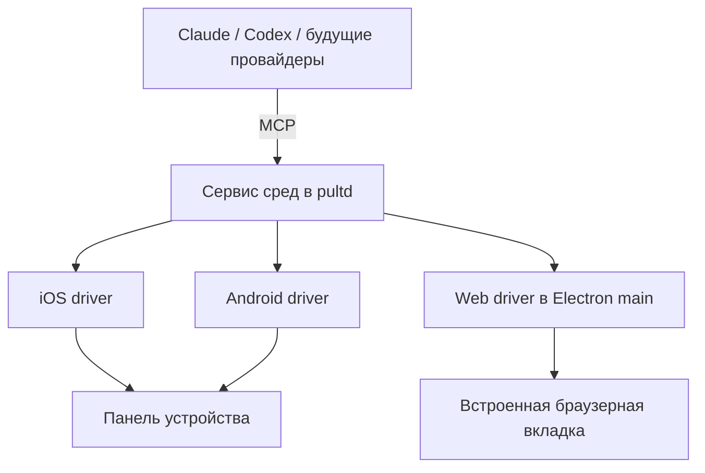

# Подключаемые симуляторы и веб-превью в Пульте

Дата: 30.10.2026. Статус: реализация согласована Павлом. Исходное архитектурное предложение ниже; текущие возможности и ограничения описаны в README, доказательства приёмки — в отчёте проверки.

Предлагается единый сервис сред выполнения: он подключает имеющиеся iOS Simulator и Android Emulator, предоставляет агентам инструменты управления и показывает пользователю тот же экран. SDK, образы устройств и мобильные helper-компоненты устанавливаются отдельно по необходимости. Веб-превью использует Chromium, который уже входит в Electron.

## Что подтверждено у других приложений

| Приложение | Подтверждённое поведение | Что берём |
|---|---|---|
| Claude Desktop | Локальная интерактивная iOS-панель использует установленный Xcode. Открывается при запуске приложения агентом, показывает действия, позволяет ручной ввод. Устройства закрепляются за сессиями. Для отсутствующих компонентов показывает настройку. | Панель рядом с чатом, подключение существующих устройств, понятный setup и учёт владельца устройства. |
| Codex в ChatGPT desktop | Общая с человеком браузерная вкладка, отдельный профиль, комментарии на странице. Встроенный Browser не предоставляется Codex CLI и IDE extension. Computer Use подключается как отдельный плагин. | Общая наблюдаемая поверхность и явные возможности среды. Инструменты desktop нельзя считать автоматически доступными через app-server. |
| Orca | Настоящий Chromium в панели, вкладки привязаны к worktree. В открытом коде есть iOS и Android backends: iOS — `simctl` + `serve-sim`, MJPEG и дерево доступности; Android — `adb` и `scrcpy`, H.264. Browser guest регистрируется как Electron `webview`. | Разделение драйверов, состояния устройства и отображения; управление через общие команды для агентов. |

Источники: [Claude iOS Simulator](https://code.claude.com/docs/en/desktop-ios-simulator), [Claude preview](https://code.claude.com/docs/en/desktop#preview-your-app), [OpenAI Browser](https://learn.chatgpt.com/docs/browser), [OpenAI Computer Use](https://learn.chatgpt.com/docs/computer-use), [Orca browser](https://www.onorca.dev/docs/browser/overview), [Orca iOS backend](https://github.com/stablyai/orca/blob/main/src/main/emulator/backends/ios-emulator-backend.ts), [Orca Android stream](https://github.com/stablyai/orca/blob/main/src/main/emulator/android/android-stream-session-starter.ts), [Orca browser registration](https://github.com/stablyai/orca/blob/main/src/main/browser/browser-manager-registration.ts).

Это наблюдаемое поведение и открытый код. Внутреннюю реализацию закрытых приложений Claude и Codex по ним восстановить нельзя. Отдельный Android Simulator pane у Claude/Codex просмотренные документы не подтверждают.

## Архитектурное решение

MCP — общий протокол инструментов для агентов. Модель вызывает «прочитай экран», «нажми кнопку», «введи текст», а драйвер переводит это в команды конкретной платформы. UI Пульта обращается к тому же сервису: человек и агент работают с одним устройством или одной вкладкой.

**В `pultd`:** обнаружение сред, готовность, закрепление за сессиями, очередь действий, доступ, установка дополнительных компонентов и журнал операций. Опциональные драйверы запускаются отдельными процессами, чтобы их сбой не останавливал чаты.

**В Electron main:** владение встроенными web contents, ограниченные действия над конкретной вкладкой и доставка кадров мобильных устройств в UI. Демон знает, какие возможности предоставляет активное окно. При закрытом окне embedded web недоступен; существующий внешний Playwright может работать отдельно. Мобильный драйвер может продолжать задачу без открытой панели.

Общий контракт: `discover`, `prepare`, `attach`, `inspect`, `screenshot`, `tap`, `swipe`, `type`, `button`, `launch`, `logs`, `detach`. Сборка, установка приложения, выполнение тестов и установка инструментов — отдельные типизированные операции. В ответах — доступные возможности, состояние, ID устройства, ID снимка и понятная причина недоступности.

Общий MCP gateway подключается до начала задачи, даже если SDK отсутствует. Стабильные инструменты discovery/setup доступны сразу; после установки меняется состояние и набор доступных действий среды, а не конфигурация MCP посреди хода. Это позволяет продолжить задачу без перезапуска CLI ради появления инструментов.

### Подключаемые компоненты

- Сначала искать существующие Xcode, simulator runtimes, Android SDK, AVD и запущенные устройства. Не дублировать их в `~/.pult`.
- Наличие Simulator/Emulator не гарантирует готовность управления: UI helper может отсутствовать. Это отдельная небольшая установка с отдельным объяснением.
- iOS: `simctl` для списка, загрузки устройства, установки/запуска приложения и screenshots. Для нажатий, дерева UI и live-потока нужен дополнительный helper. Первый кандидат для проверки — `serve-sim` по примеру Orca; альтернатива — idb. Финальный выбор после проверки совместимости, лицензии, подписи и поставки.
- Android: `adb` для устройства, приложения, ввода и logs; дерево элементов — через UIAutomator; живое изображение — через отдельно поставляемый `scrcpy`-компонент. Отсутствующий emulator/runtime/AVD устанавливать или создавать только по согласованному setup-плану.
- Веб: отдельный `WebContentsView` на Chromium Electron. Свой профиль сессии, адресная строка, назад/вперёд, reload, размеры viewport, console/network errors, screenshot. Комментарии к элементам — следующим небольшим шагом.

[Mobile MCP](https://github.com/mobile-next/mobile-mcp) уже предлагает общий набор мобильных инструментов для Claude/Codex и других клиентов. Это кандидат для быстрого spike и сравнения, не утверждённая зависимость: проверяем реальные платформенные helpers, ограничения и возможность ограничить конкретным устройством. Его облачные функции для этого плана не нужны. [MobileBuildMCP](https://github.com/getsentry/MobileBuildMCP), ранее XcodeBuildMCP, — дополнительный кандидат для build/test workflows, не обязательный фундамент.

## Совместимость моделей

Подключение делается на уровне провайдера через существующий `mcpExtras`, без отдельных инструментов для каждой модели. Сейчас в продукте поддерживаются Claude и Codex; будущий opencode подключается через свой адаптер, когда он появится.

Модель с поддержкой изображений получает screenshot и дерево элементов. Текстовая модель получает дерево с текстом, координатами и идентификаторами. После изменения экрана старые идентификаторы отклоняются или требуют нового `inspect`. Пустое дерево, Canvas или игра означают, что текстовая модель не может полноценно проверить внешний вид: Пульт показывает ограничение, предлагает подходящую модель или ручную проверку. Наличие MCP само по себе не означает поддержку изображений.

Видеопоток предназначен человеку. Модель запрашивает отдельные снимки по необходимости; непрерывная передача кадров модели не нужна. В интерфейсе сообщать, что запрошенные снимки отправляются выбранному провайдеру.

## Как выглядит задача пользователя

1. Пользователь просит: «Проверь onboarding Android-приложения».
2. Агент получает список доступных сред и вызывает `prepare`. Пульт различает: инструмент отсутствует, runtime отсутствует, устройство не создано, устройство выключено, управление готово.
3. Если чего-то не хватает, появляется предложение: какие компоненты, версии, источник, путь, объём загрузки/места, зачем они нужны. Если точный объём неизвестен, показывается оценка или это прямо указано.
4. Пользователь выбирает «Установить и продолжить», «Выбрать существующее» или «Пропустить». После согласия виден прогресс; отмена не запускает последующие шаги. Лицензии, Apple ID, sudo и системные диалоги могут потребовать ручного действия. Пароли в чат не запрашиваются.
5. Пульт перепроверяет готовность, подключает устройство и открывает панель рядом с чатом. Видны имя устройства, версия OS, агент-владелец, текущая операция и ошибка при её возникновении.
6. Агент запускает приложение, проверяет сценарий, сохраняет нужные снимки и тестовые результаты. Пользователь может нажать «Взять управление», затем вернуть его агенту.

Обнаружение мобильного проекта — только подсказка. Автоматическое предложение возникает, когда задача действительно требует запуска/UI-проверки; изменение документации в iOS-репозитории не должно вызывать загрузку симулятора. Состояние готовности хранится между ходами, завершённая установка не предлагается повторно.

Android Studio целиком не обязателен: достаточно совместимых CLI/SDK-компонентов. Официальная документация уже помечает `sdkmanager` устаревшим и рекомендует `android sdk`; реализация должна обнаруживать установленную версию и выбирать поддерживаемый путь, сохраняя совместимость со старыми SDK. [Android SDK tools](https://developer.android.com/tools/sdkmanager).

iOS Simulator требует macOS и полного Xcode с платформой iOS. Пульт может помочь скачать недостающий runtime и проверить установку, но не обещает полностью автоматическую установку Xcode и прохождение лицензий. Это ограничение отражается прямо в setup. [Требования и настройка Claude iOS](https://code.claude.com/docs/en/desktop-ios-simulator).

## Доступ и управление

Одно устройство может иметь только одного управляющего агента; остальные наблюдают. Закрепление имеет срок действия и поколение. Перехват человеком отменяет очередь, отзывает старое поколение и не принимает запоздалые команды. Уже начатую системную операцию нельзя всегда мгновенно отменить: UI показывает её завершение, а агент перед продолжением перечитывает экран. Чужие запущенные устройства автоматически не выключаются; собственные helpers и устройства учитываются отдельно.

Установка компонентов и выдача доступа к устройству — разные решения. Предлагается отдельное согласие на скачивание/изменение системного окружения по просьбе Павла. Это **новое продуктовое поведение**, которое нужно явно описать для `full`: после предоставления доступа обычные действия на устройстве идут без скрытых дополнительных вопросов; существующий режим shell не меняется. Нельзя выдавать этот сервис за песочницу: агент с полным доступом пользователя может выполнять команды в обход него.

Текущий `approvalBrowserRefusal` запрещает браузер Claude в `full`, Codex в `workspace/full`, поскольку полагается на вопросы CLI. Для новой интеграции нужен собственный сервис доступа с ключом конкретной сессии и ограниченным набором операций, а также явный пересмотр этого правила. Установщик принимает утверждённый manifest пакетов, а не произвольную команду от модели.

Проектная веб-страница открывается в отдельном contents: без preload Пульта, Node, daemon token и IPC приложения; `contextIsolation` и sandbox включены. Команды браузеру проходят через разрешённый перечень операций для одного contents, без публичного debugging-порта. Проверяются redirects, popup, downloads, permissions и переходы к `app://pult`/`file://`. Сборка проекта выполняет код на компьютере и остаётся в существующем режиме доступа, а не получает разрешение от факта подключения симулятора.

## Производительность и хранение

Кадры передаются отдельным временным каналом с ограничением частоты и очереди; скрытая панель снижает частоту, а остановленная подписка освобождает поток. В журнал событий пишутся действия, ошибки и ссылки на выбранные screenshots, не видео. Сейчас у транспорта есть ограничение строки 1 МиБ и уже существует вынос изображений в blobs: live base64 через журнал не подходит.

Helpers устанавливаются в версионированное хранилище отдельно от версии Пульта: фиксированные версии, суммы, блокировка конкурирующих установок и атомарная активация. Не переносить автоматически политику Orca по снятию quarantine с helper-пакета; способ подписи и запуска проверяется отдельно. Удаление дополнения Пульта не удаляет общий SDK/Xcode пользователя.

## Варианты и выбор

| Вариант | Плюс | Ограничение | Решение |
|---|---|---|---|
| Общий сервис + отдельные драйверы | Одинаковое управление для провайдеров и UI, лёгкая базовая поставка | Нужно реализовать lifecycle и доступ | Рекомендуется |
| Просто добавить сторонний Mobile MCP каждой модели | Быстро проверить управление | Само по себе не даёт общую панель, закрепление и setup | Использовать в spike для сравнения |
| Показывать поток внешнего Chrome | Максимальное повторное использование текущего Playwright | Картинка вместо полноценной встроенной страницы | Запасной вариант после измерений |
| WebContentsView + ограниченный browser bridge | Полноценное превью, использует уже поставляемый Chromium | Новый backend управления встроенной вкладкой | Основной web-дизайн после same-target spike |

Нельзя показывать одну вкладку пользователю, а управлять другой с тем же URL: cookies, маршруты и состояние будут расходиться. Существующий внешний Playwright остаётся отдельным режимом; его работа не доказывает поддержку встроенного contents. [Electron WebContentsView](https://www.electronjs.org/docs/latest/api/web-contents-view).

## Этапы и приёмка

| Этап | Результат | Проверяемая приёмка |
|---|---|---|
| 0. Технический spike | Выбраны iOS helper, Android stream и web bridge | На обеих мобильных платформах: snapshot → tap → новый snapshot; screenshot реально читается Claude и Codex. Веб: пользователь вводит уникальный текст, агент читает его в том же target и меняет состояние обратно. Проверена подпись/helper lifecycle. |
| 1. Discovery и общий сервис | MCP, готовность, доступ, закрепление и setup-карточки | Без SDK обычные чаты работают без загрузок. Подключение готового устройства не скачивает SDK. Две сессии не управляют одним устройством одновременно. Перезапуск снимает зависшие закрепления. |
| 2. Web preview | Встроенная вкладка, управление из Claude/Codex, logs | Оба провайдера проверяют локальную страницу; видимое состояние совпадает. Вредная страница не получает IPC/Node/token. Отдельно проверено поведение при закрытии окна. |
| 3. Android целиком | Существующий emulator + live panel + установка отсутствующих частей | Build/install/launch/UI-check/logcat/test result; ручной перехват; отказ от установки не меняет окружение; одобренная установка заканчивается повторной диагностикой. |
| 4. iOS целиком | Xcode/runtime/helper + live panel + guided setup | То же для Simulator, включая текстовый ввод, поворот и дерево UI. Нет Xcode — точные шаги. Не выключается чужой Simulator. |
| 5. Завершение сценария | Предложения по задаче, отчёт, screenshots, очистка | На каждом провайдере проходятся: всё установлено; нет runtime; отказ/отмена; crash helper; перехват; смена сессии; текстовая модель и пустое дерево. |

Setup входит в каждый вертикальный этап, не откладывается до завершения всех драйверов. Первый производственный приоритет — общий сервис и web, затем Android, затем iOS; результаты spike могут поменять порядок мобильных платформ. Оценку сроков дать после spike: основная неизвестность — поставка и совместимость iOS helper, а также управление встроенным contents без расширения доступа ко всему Electron.

Точки интеграции: новые `src/runtimes/*` и MCP facade; существующие `src/mcp/session.ts`, `src/adapters/types.ts`, registry/turn settings, daemon RPC/events и `doctor`; `shell/src/main.ts`, `contract.ts`, `preload.ts`; новая React-панель. Публичный API сторонних плагинов, физические телефоны и удалённые фермы устройств — последующие отдельные задачи.

Ранее план 13 откладывал встроенный браузер, план 16 — управление компьютером. Предложение пересматривает первое решение и добавляет ограниченное управление выбранными виртуальными устройствами; общий desktop automation не требуется.
